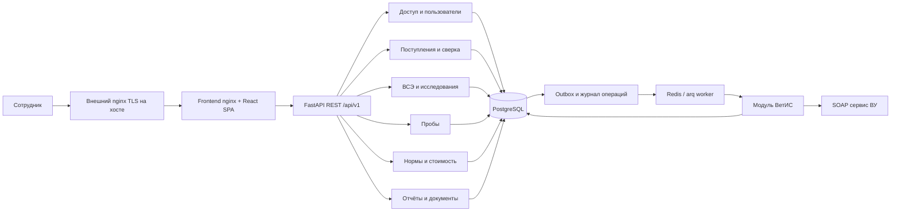

# Карта архитектуры и передача в ТЗ

06.11.2026. Это обзор принятых архитектурных решений, их нормативный текст — в ADR. Выбор выполнен автором по поручению владельца; отдельное ревью как условие написания ТЗ не требуется. Мясной MVP не включает молочное производство, повторные ветосмотры, склад, продажи, исходящие после ВСЭ/для проб, электронную подпись и почтовое восстановление.

## Состав системы

Worker использует тот же backend-образ и внутренние прикладные команды. Модуль ВетИС имеет отдельный контракт и ответственность; выделение в сетевой микросервис пока не требуется. Redis не хранит единственную копию операции. Между внешней системой и БД нет общей транзакции: неопределённость явно учитывается в журнале и блокирует продолжение.

## Границы владения данными

| Модуль | Владеет | Не должен делать |
| --- | --- | --- |
| identity | Пользователи, сеансы, назначения, делегирование | Давать администратору рабочее чтение по факту управления пользователем |
| arrivals | Партия, сверка, документальные и фактические количества, локальное подтверждение | Считать сохранённую форму внешним гашением |
| examinations | Единственная существующая ВСЭ партии, результаты, итог | Создавать постоянный неполный черновик, отдельные результаты по тушам |
| samples | Самостоятельный отбор и неизменяемая утилизация всего остатка вида | Удалять физический факт вместе с ВСЭ, создавать исходящий ВСД |
| catalog_pricing | Настройки, нормы, лабораторные цены, серверный расчёт | Переоценивать сохранённые данные новым тарифом |
| reporting | Операционные запросы и неизменяемый снимок 5-вет | Пересчитывать сохранённую матрицу по текущим ВСЭ |
| documents | Единая модель вывода, PDF/XLSX | Выдавать документ без пригодного основания, считать печать подписью |
| integrations/vetis | SOAP, синхронизация, заявки и доказательства результата | Выбирать врачебный итог, выдавать местную роль за полномочия ВУ |

## Ключевые операции

**Сохранение ВСЭ.** Проверка актуального доступа и срока → блокировка партии/карточки/проб → проверка ревизии → валидация каталога и введённых результатов → снимки нормы/стоимости → один физический отбор → статус ожидания/завершения → единый commit. В ожидании заполнено всё, кроме разрешённого итогового блока. За пределами дня создания отдельная команда меняет только VSE-F35–37. Время первого завершения не сдвигается последующей правкой.

**Удаление ВСЭ.** В пределах дня и области удаляется карточка без восстановления; номер освобождается. Партия возвращается в рабочую очередь, но подтверждённое гашение остаётся. Физический отбор и утилизация самостоятельны. Новая ВСЭ использует доступную прежнюю пробу; новый отбор требует явного действия. Сохранённый отчёт сохраняет свою матрицу и минимальные доказательные вклады.

**Внешняя приёмка.** Записать намерение/outbox → передать заявку → получить идентификатор → читать результат → проверить успех/состав → зафиксировать подтверждение. Таймаут не равен отказу. Неизвестность сначала разрешается чтением факта; повтор необратимой команды без доказанной безопасности запрещён.

**5-вет.** Согласованный набор завершённых ВСЭ за завершённое полугодие → матрица и классификация → подписанный предварительный payload в открытой форме → семь ручных кодов → сохранение именно показанного снимка. Изменение источника между формированием и сохранением не меняет матрицу. Новое формирование после удаления отчёта использует текущие данные.

## Последовательность разработки

Это порядок архитектурных зависимостей для будущего ТЗ, не план выполнения кода в текущей задаче.

| Этап | Результат | Условие завершения |
| --- | --- | --- |
| 0. Передача в ТЗ (выполнено) | Приняты ADR-001–024 и контракты параметров; сформирован agent-handoff | Архитектурных вариантов на согласование нет |
| 1. Платформа и доступ | PostgreSQL, миграции, FastAPI/SPA, сеансы/Casbin, области, пользователи, CI | Проверены четыре роли, отзыв, запрет обхода, один origin |
| 2. Локальная предметная модель | Сверка, ВСЭ, ожидание, расчёт, пробы, справочники, документы, отчётные снимки | Локальные сценарии проверены через контрактные данные; источник подтверждённой приёмки изолирован портом; демонстрационные данные не попадают в production |
| 3. Эксплуатационная готовность локальных модулей | Backup/restore, наблюдаемость, ошибки, установка | Закрыты применимые OPS/формы/нормы; write ВетИС выключен |
| 4. Интеграция ВетИС — получение | Реальное получение входящих транспортных ВСД через ВУ, обновление без дублей | Определены credentials/профиль/инициатор/площадки, полный проход пагинации; write выключен |
| 5. Интеграция ВетИС — гашение | Полное/частичное принятие, полный возврат и проверка результата | После готовности этапа 4 выполнены manifest/capability-проверки, настроены личные полномочия и read-reconcile ADR-019; UNKNOWN безопасно обрабатывается |

Разработка интеграции идёт после локального контура. Внутренний порт и структура внешнего журнала проектируются заранее, чтобы не переделывать предметные модули. На этапе только чтения нельзя объявлять готовым весь MVP: новые ВСЭ/заключения требуют подтверждённой приёмки. Само ручное гашение в Меркурии не снимает это ограничение; нужна проверка внешнего факта и состава. В отсутствие такого чтения процесс останавливается с объяснением.

## Что перенести в техническое задание

1. Зафиксировать версии входных документов и принятые ADR. Сохранить идентичность FT v2.0 и CHK/VSE-полей; старые FT v1 не объединять по совпадающему номеру.
2. Для каждого модуля задать API-запросы/ответы, схемы данных, constraints и индексы на основе концептуальных связей ADR-016; DDL разрабатывается следующей задачей.
3. Для каждой команды описать предусловия доступа, блокировки/ревизию, атомарный состав, время, idempotency key, ответы об ошибках и повтор. Отдельно описать удаление и UNKNOWN.
4. Приложить утверждённые реальные нормы, цены, единицы, классификацию и официальные формы INPUT-02–05. Примерные значения макетов не использовать как исходные нормативы.
5. Для ВетИС оформить отдельные части ТЗ «получение» и «гашение», versioned manifest SOAP-контракта ВУ и матрицу CHK-факт → XML → подтверждённый результат. Служебное чтение для восстановления выбрано в ADR-019.
6. Использовать [матрицу FT → ADR](traceability.md) и SC/AT из ФТ как основу приёмки; дополнить техническими отказами/конкуренцией из разделов «Проверка». Различать будущие проверки и фактически выполненные.
7. Перенести выбранные численные цели ADR-023 и платформу ADR-024 в инфраструктурную часть ТЗ; адреса/секреты/контакты задать как параметры установки.

Пакет передаётся агенту для написания полного ТЗ. ТЗ включает схемы/настройку пока отсутствующих параметров и критерии проверки реального ВУ-профиля, каталогов, форм и эксплуатации; получение значений необходимо для зависимого запуска, а не для повторного выбора архитектуры.
